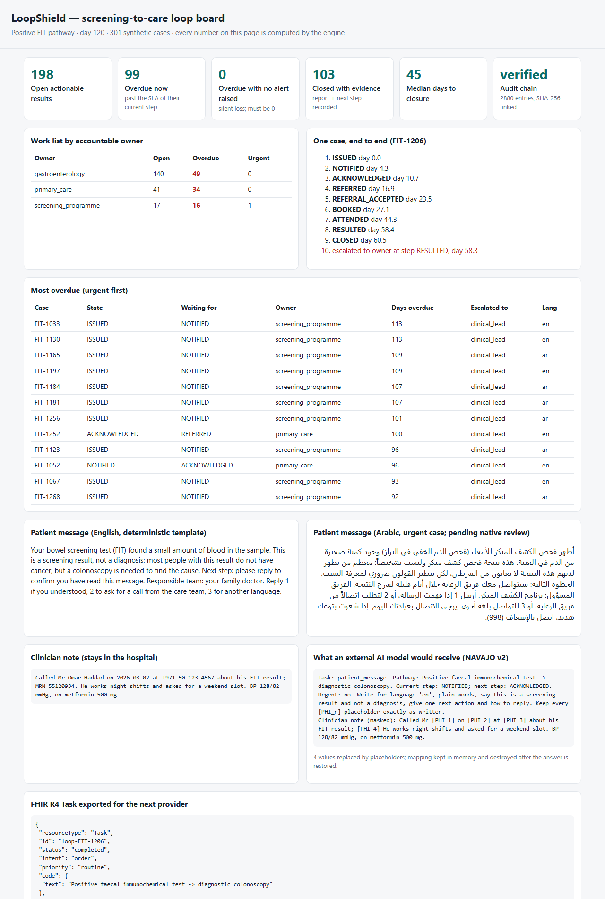

# LoopShield

**Every actionable screening result gets an owner, a deadline, an escalation path and a documented closure; if AI is
used to draft messages, identifiers are masked on the hospital's machine first, which in our benchmark cut the PHI
reaching the model from 100 % to 12.9 % (4.1 % in maximum mode). Masking reduces exposure; it does not remove it.**

Prototype for the [Future Health Digital Innovation Challenge](https://hack2skill.com/event/futurehealthchallenge/),
Challenge 05 *Closing the Screening-to-Care Loop*. Built on [Project NAVAJO](https://github.com/Agnuxo1/edge-privacy-gateway)
(MIT) for privacy. Status: **prototype on synthetic data**: no clinic uses it, it is not a medical device, and no
result below comes from real patients.



## The problem

A positive screening test helps only if it leads to a diagnosis. Results cross laboratories, screening programmes,
family doctors and specialists, and many are never followed up: 6.8–62 % of laboratory results in a systematic review,
and only 58–84 % of positive faecal tests followed by colonoscopy within a year in four US health systems. Colonoscopy
after 10 months is associated with more advanced colorectal cancer. Sources in [docs/SOURCES.md](docs/SOURCES.md).

## What it does

- **Case engine** ([loopshield/engine.py](loopshield/engine.py)): each result is a case that moves through its pathway
  (notify → acknowledge → refer → accept → book → attend → result → close). One accountable owner at every step, a due
  time per step, automatic escalation owner → care navigator → clinical lead (every 7 days), then a reminder to the
  clinical lead every 30 days while the step stays stuck; urgent cases go to the clinical lead at once.
- **Patient replies** (`patient_reply`): 1 = understood (records acknowledgement), 2 = call me, 3 = another language
  (both alert a care navigator at once).
- **No silent closure**: a case closes only with evidence (report reference and next step) or a documented decision by
  a named clinician; "unreachable" needs three recorded attempts. Missed appointments and rejected referrals send the
  case back with a reason.
- **Tamper-evident audit**: every event in a SHA-256 hash chain; `verify()` detects edited, reordered or removed
  entries, and `verify(anchor=...)` with a head hash stored elsewhere also detects a fully rewritten log.
- **Patient messages per pathway** (positive FIT, abnormal mammogram) in English and Arabic ([loopshield/messages.py](loopshield/messages.py)): *screening result, not
  a diagnosis*, one next action, reply codes to confirm understanding or ask for a call. Arabic is a prototype
  translation pending native-speaker and clinical review.
- **FHIR R4 export** (Task, Communication, Provenance) for hand-off between providers.
- **Privacy gateway** ([loopshield/privacy.py](loopshield/privacy.py)): if a language model is used to draft messages,
  identifiers in the clinician's note are replaced on the local machine by NAVAJO v2, a final check refuses to send
  if an e-mail, ID number or phone number is still visible, and the answer is restored locally.

## Quick start

```bash
pip install numpy==2.2.6 pytest==8.3.5
python -m pytest -q tests              # 20 tests: engine rules, escalation, audit, privacy, messages, FHIR
python demo/run_demo.py                # 300 synthetic cases + 1 urgent -> demo/out/dashboard.html
python sim/fuzz.py --n 100000          # engine invariants under random events
python sim/simulate.py                 # pre-registered pathway simulation -> results/sim/
python sim/make_table.py               # results/sim/table.md
```

The privacy benchmark needs the public Gretel dataset and Presidio:

```bash
pip install presidio-analyzer==2.2.360 spacy==3.8.7 pyarrow==21.0.0
pip install https://github.com/explosion/spacy-models/releases/download/en_core_web_lg-3.8.0/en_core_web_lg-3.8.0-py3-none-any.whl
curl -L -o gretel_test.parquet https://huggingface.co/datasets/gretelai/gretel-pii-masking-en-v1/resolve/e06eb1499ca8d54470f085021cd8e54f9efac7fd/data/test-00000-of-00001.parquet
python bench/phi_payload.py --parquet gretel_test.parquet --out results/phi
```

## Results

All experiments were pre-registered in [experiments/PREREGISTRO.md](experiments/PREREGISTRO.md) before running; every
run, including negative findings, is in [experiments/LOG.md](experiments/LOG.md).

### 1. Engine safety (E-ENG)

100,000 random event sequences (1.54 million events, including invalid ones), case invariants checked **after every
event** and the audit chain every 20 cases: **0 violations** (no closure without evidence or named clinician, no open
case without owner, urgent cases escalated to the clinical lead at the moment they are flagged and never below it,
every call-back request alerts a navigator, audit chain intact). Limitation: random sequences seldom reach the
evidence-closure path (3 cases); that path is covered by unit tests.

### 2. Simulated positive-FIT pathway (E-SIM)

10 replicates × 10,000 patients. Usual-care timing calibrated to the best and worst of four US systems (Chubak 2016);
intervention effect taken from the mFOCUS cluster-randomised trial (Atlas 2023: outreach + navigation +8.5 points
[4.8–12.0] within 120 days of an overdue result; EHR reminders alone, no effect). Tracker arms run through the real
engine.

| System | Arm | Colonoscopy within 12 months | Difference vs usual care [2.5–97.5 pct] | Unresolved cases with no alert raised |
|---|---|---|---|---|
| Low-performing | Usual care | 58.0 % | — | 100 % (assumed: no tracking) |
| Low-performing | Reminders-only tracker | 56.9 % | −1.2 [−5.2, +2.2] | 0 % (measured) |
| Low-performing | **LoopShield** | **62.8 %** | **+4.8 [+1.5, +6.4]** | **0 %** (measured) |
| High-performing | Usual care | 83.9 % | — | 100 % (assumed) |
| High-performing | Reminders-only tracker | 82.9 % | −1.0 [−4.4, +0.1] | 0 % (measured) |
| High-performing | **LoopShield** | **85.8 %** | **+2.0 [+1.1, +2.4]** | **0 %** (measured) |

Full table with sensitivity analysis: [results/sim/table.md](results/sim/table.md). How to read it: the size of the
benefit is an input from one US trial, so the simulation shows what that effect would mean for the pathway, not that
LoopShield produces it; visibility alone (reminders) does not move completion, outreach does. Escalation burden is high in
the low-performing scenario (about 14 escalations per case, 4 in the high-performing one), a real alert-fatigue risk
that a pilot has to tune. An earlier version stopped alerting once the 3-level ladder was used up: 33 % (slow
system) and 83 % (fast system) of late, still-open cases then got no alert after day 60. The current version keeps
reminding the clinical lead every 30 days (0 % without an alert after day 60; median 4.6–6.9 days from day 60 to the next
alert), which is part of that burden. Both runs are kept (`results/sim_v01_ladder_exhausts/`, `results/sim/`).
"Alert" means an escalation recorded by the engine; this prototype has no delivery channel, so delivery and reading
are not measured (FHIR exports them as Communications in `preparation`).

### 3. Privacy: what reaches an external AI model (E-PHI, own technology)

Pre-registered benchmark on all 251 health documents of the public Gretel `gretel-pii-masking-en-v1` test split
(synthetic, Apache-2.0), 10,239 PHI characters. Lower exposure is better. The NAVAJO v2 detector was frozen before this
run (Agnuxo1/edge-privacy-gateway commit 1bea827) and not tuned on this data.

| What is sent to the model | PHI characters left visible [3 partitions, mean ± SD] | Notes with ≥ 1 identifier fully visible | Precision of masking | Clinical values kept (n = 33) | ms per note |
|---|---|---|---|---|---|
| Raw note | 100 % | 100 % | — | 100 % | — |
| Microsoft Presidio (control, default English, spaCy lg) | 22.8 % (22.7 ± 2.2) | 49.8 % | 0.82 | 90.9 % | 15.4 |
| NAVAJO v1 (before this work) | 28.3 % (28.0 ± 5.7) | 47.8 % | 0.44 | 97.0 % | 0.19 |
| **NAVAJO v2 (default mode, no ML model)** | **12.9 %** (12.9 ± 1.5) | **21.9 %** | **0.88** | **100 %** | **0.32** |
| **NAVAJO v2 + Presidio (maximum mode)** | **4.1 %** (4.0 ± 1.3) | **6.4 %** | 0.83 | 90.9 % | 13.8 |

Paired bootstrap over notes (1,000 resamples, seeds 0/1/2): NAVAJO v2 − Presidio = **−9.9 points**
[−13.7, −6.5] / [−13.4, −6.7] / [−13.3, −6.5]; hybrid − Presidio = **−18.8 points** [−21.3, −16.3] / [−21.0, −16.5] /
[−21.2, −16.4]. H1 (own technology lowers exposure versus the professional control) is supported. The final guard
would have refused to send 1 of 251 notes (0.4 %) in default mode. Limits: one synthetic English dataset, whose health
documents were partly inspected (200) in the NAVAJO v2 project's exploratory pilot; small clinical-value sample; even the
best mode leaves 4 % of PHI characters visible, so a data-processing agreement or a local model is still required.
Results: [results/phi/phi_results.json](results/phi/phi_results.json).

## Repository

| Path | Content |
|---|---|
| `loopshield/` | engine, pathways, messages, privacy gateway, FHIR export, NAVAJO v2 detector (vendored) |
| `vendor/navajo_egp/` | Project NAVAJO core (MIT, same author) |
| `demo/` | offline demo board (`demo/out/dashboard.html`, 300 synthetic cases + 1 urgent) |
| `sim/` | pathway simulation, fuzzer, table script |
| `bench/` | privacy benchmark |
| `experiments/` | pre-registration and log |
| `results/` | outputs of the runs reported above |
| `docs/SUBMISSION.md` | technical documentation for the challenge: requirements, governance, assumptions, dependencies, limitations |

## Limitations

Synthetic data only; no EHR, laboratory or messaging integration yet; effect sizes transferred from US studies; Arabic
limited to message templates (no Arabic de-identification evaluated); NAVAJO masking reduces exposure but does not
anonymise, and pseudonymised data remain personal data; FHIR output structurally tested only. Full list in
[docs/SUBMISSION.md](docs/SUBMISSION.md#8-assumptions-dependencies-and-limitations).

## Licence

MIT. See [NOTICE](NOTICE) for vendored components and data licences.
