# LoopShield

**Every actionable screening result gets an owner, a deadline, an escalation path and a documented closure; if AI is
used to draft messages, identifiers are masked on the hospital's machine first, which in our benchmark cut the PHI
reaching the model from 100 % to 12.9 % (4.1 % in maximum mode). Masking reduces exposure; it does not remove it.**

Prototype for the [Future Health Digital Innovation Challenge](https://hack2skill.com/event/futurehealthchallenge/),
Challenge 05 *Closing the Screening-to-Care Loop*. Built on [Project NAVAJO](https://github.com/Agnuxo1/edge-privacy-gateway)
(MIT) for privacy. Status: **prototype on synthetic data**: no clinic uses it, it is not a medical device, and no
result below comes from real patients.

[](https://github.com/Agnuxo1/loopshield/actions/workflows/ci.yml) [](LICENSE)   [](experiments/PREREGISTRO.md) [](results/fuzz.json) [](https://hack2skill.com/event/futurehealthchallenge/)

[**What it does**](#what-it-does) · [**Results**](#results) · [**Limitations**](#limitations) · [**Pre-registration**](experiments/PREREGISTRO.md) · [**Experiment log**](experiments/LOG.md) · [**Simulation table**](results/sim/table.md) · [**Privacy results**](results/phi/phi_results.json) · [**Submission doc**](docs/SUBMISSION.md)


**Contents** — [The problem](#the-problem) · [Background](#background) · [What it does](#what-it-does) · [Quick start](#quick-start) · [Results](#results) · [Repository](#repository) · [Limitations](#limitations) · [Real-world applications](#real-world-applications) · [Possible improvements](#possible-improvements) · [Future work](#future-work) · [Licence](#licence) · [Bibliography](#bibliography)

## The problem

<p align="center">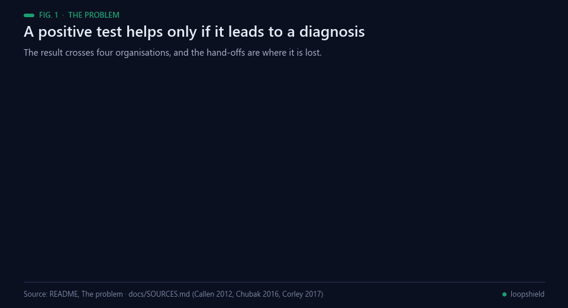<br><sub>Fig. 1 — Where the loop breaks. Sources: docs/SOURCES.md (Callen 2012, Chubak 2016, Corley 2017).</sub></p>

A positive screening test helps only if it leads to a diagnosis. Results cross laboratories, screening programmes,
family doctors and specialists, and many are never followed up: 6.8–62 % of laboratory results in a systematic review,
and only 58–84 % of positive faecal tests followed by colonoscopy within a year in four US health systems. Colonoscopy
after 10 months is associated with more advanced colorectal cancer. Sources in [docs/SOURCES.md](docs/SOURCES.md).

## Background

<p align="center">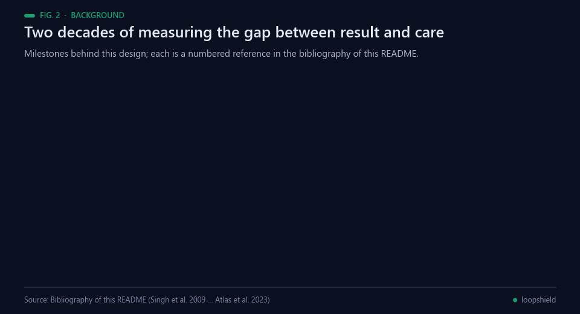<br><sub>Fig. 2 — Milestones behind this design. Sources: the bibliography below.</sub></p>

The gap this prototype addresses has been measured for two decades, and the measurements are consistent.
Singh and colleagues found in 2009 that a substantial share of abnormal diagnostic imaging results in an
outpatient setting were not acted on in time [[6](#ref-6)]; Callen and colleagues' systematic review put the
share of laboratory results never followed up at 6.8–62 % [[5](#ref-5)]. For colorectal screening specifically,
Chubak and colleagues measured colonoscopy within 12 months of a positive faecal blood test in four US
health systems and found 58.1–83.8 %, with median waits from 41 to 174 days [[2](#ref-2)] — the two end points
this simulation is calibrated to. Why the delay matters was settled by Corley and colleagues: longer time
to colonoscopy after a positive test is associated with a higher risk of colorectal cancer and with more
advanced stage at diagnosis [[3](#ref-3)], and colonoscopy screening itself reduces incidence [[9](#ref-9)].

What works is also measured, and it is not what most systems build. Sittig and Singh argued directly that an
electronic alert is not a loop: follow-up needs a named owner and a process around the alert [[7](#ref-7)], and
Murphy and colleagues went further, using record-based triggers to find the delayed cases that no alert had
surfaced [[8](#ref-8)]. Selby and colleagues' systematic review found moderate evidence for patient navigators
and provider reminders, with absolute differences ranging from −7.4 to +25 points [[4](#ref-4)]. The strongest
single estimate is the mFOCUS cluster-randomised trial, where outreach plus navigation raised follow-up of
overdue abnormal screening results by 8.5 points [4.8–12.0] within 120 days, while EHR reminders alone moved
nothing [[1](#ref-1)]. That split — reminders no, outreach yes — is the finding the simulation in this
repository reproduces, because it is the effect it was given.

The privacy side borrows from an older literature. Sweeney's *k*-anonymity showed that removing names is not
enough, because combinations of quasi-identifiers can still single a person out [[10](#ref-10)], and the i2b2
de-identification challenge turned clinical de-identification into a measurable task [[11](#ref-11)]. The
tamper-evident log is Haber and Stornetta's hash chain [[12](#ref-12)], the intervals are bootstrap intervals
[[13](#ref-13)], the hand-off format is FHIR R4 [[14](#ref-14)], the control in the privacy benchmark is Microsoft
Presidio [[15](#ref-15)] on the public Gretel test split [[16](#ref-16)], and the masking itself is the author's
Project NAVAJO [[17](#ref-17)]. Under the GDPR, pseudonymised data remain personal data [[18](#ref-18)], which is why
this README says masking reduces exposure rather than removing it.

## What it does

<p align="center">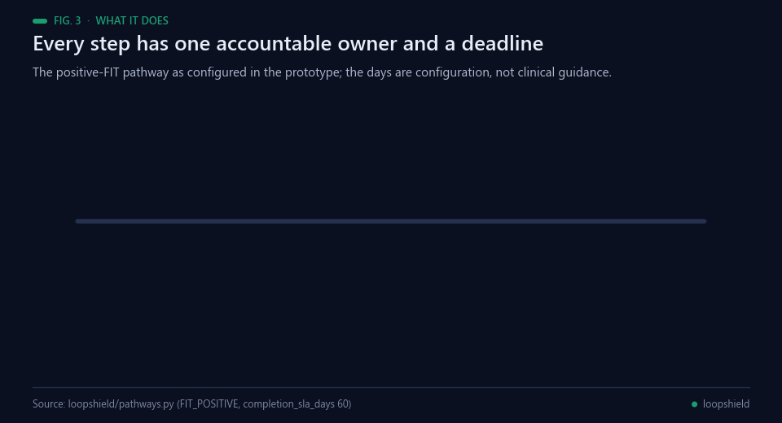<br><sub>Fig. 3 — The configured pathway. Data: loopshield/pathways.py.</sub></p>

- **Case engine** ([loopshield/engine.py](loopshield/engine.py)): each result is a case that moves through its pathway
  (notify → acknowledge → refer → accept → book → attend → result → close). One accountable owner at every step, a due
  time per step, automatic escalation owner → care navigator → clinical lead (every 7 days), then a reminder to the
  clinical lead every 30 days while the step stays stuck; urgent cases go to the clinical lead at once.
- **Patient replies** (`patient_reply`): 1 = understood (records acknowledgement), 2 = call me, 3 = another language
  (both alert a care navigator at once).

<p align="center">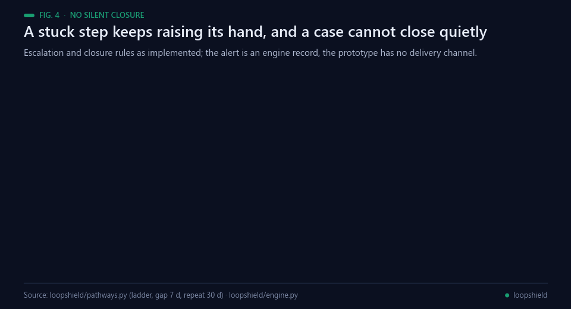<br><sub>Fig. 4 — Escalation and closure, as implemented in loopshield/engine.py.</sub></p>

- **No silent closure**: a case closes only with evidence (report reference and next step) or a documented decision by
  a named clinician; "unreachable" needs three recorded attempts. Missed appointments and rejected referrals send the
  case back with a reason.

<p align="center">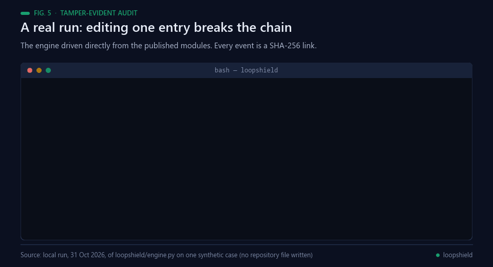<br><sub>Fig. 5 — A real local run: one edited entry turns <code>verify()</code> to False.</sub></p>

- **Tamper-evident audit**: every event in a SHA-256 hash chain; `verify()` detects edited, reordered or removed
  entries, and `verify(anchor=...)` with a head hash stored elsewhere also detects a fully rewritten log.
- **Patient messages per pathway** (positive FIT, abnormal mammogram) in English and Arabic ([loopshield/messages.py](loopshield/messages.py)): *screening result, not
  a diagnosis*, one next action, reply codes to confirm understanding or ask for a call. Arabic is a prototype
  translation pending native-speaker and clinical review.
- **FHIR R4 export** (Task, Communication, Provenance) for hand-off between providers.

<p align="center">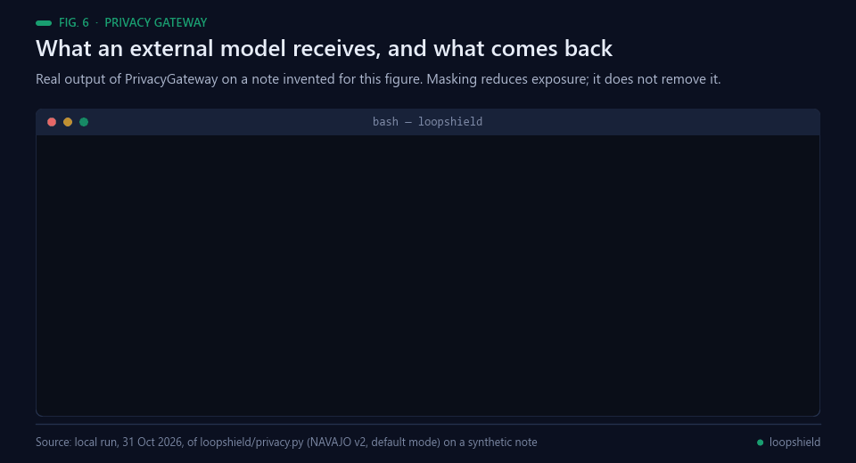<br><sub>Fig. 6 — Real output of <code>PrivacyGateway</code> on a note invented for this figure.</sub></p>

- **Privacy gateway** ([loopshield/privacy.py](loopshield/privacy.py)): if a language model is used to draft messages,
  identifiers in the clinician's note are replaced on the local machine by NAVAJO v2, a final check refuses to send
  if an e-mail, ID number or phone number is still visible, and the answer is restored locally.

## Quick start

<p align="center">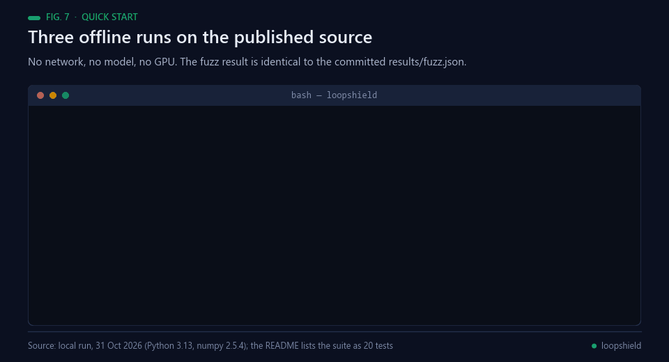<br><sub>Fig. 7 — A real local run on CPU: the fuzz result is identical to the committed results/fuzz.json.</sub></p>

```bash
pip install numpy==2.2.6 pytest==8.3.5
python -m pytest -q tests              # 20 tests: engine rules, escalation, audit, privacy, messages, FHIR
python demo/run_demo.py                # 300 synthetic cases + 1 urgent -> demo/out/dashboard.html
python sim/fuzz.py --n 100000          # engine invariants under random events
python sim/simulate.py                 # pre-registered pathway simulation -> results/sim/
python sim/make_table.py               # results/sim/table.md
```

The privacy benchmark needs the public Gretel dataset and Presidio:

```bash
pip install presidio-analyzer==2.2.360 spacy==3.8.7 pyarrow==21.0.0
pip install https://github.com/explosion/spacy-models/releases/download/en_core_web_lg-3.8.0/en_core_web_lg-3.8.0-py3-none-any.whl
curl -L -o gretel_test.parquet https://huggingface.co/datasets/gretelai/gretel-pii-masking-en-v1/resolve/e06eb1499ca8d54470f085021cd8e54f9efac7fd/data/test-00000-of-00001.parquet
python bench/phi_payload.py --parquet gretel_test.parquet --out results/phi
```

## Results

All experiments were pre-registered in [experiments/PREREGISTRO.md](experiments/PREREGISTRO.md) before running; every
run, including negative findings, is in [experiments/LOG.md](experiments/LOG.md).

<p align="center">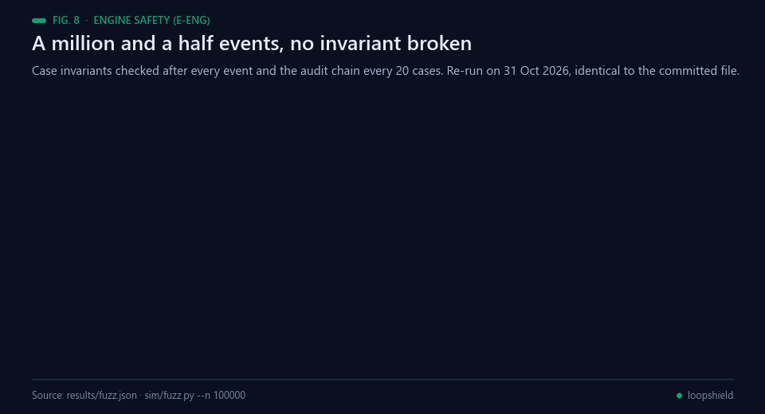<br><sub>Fig. 8 — The fuzz run. Data: results/fuzz.json.</sub></p>

### 1. Engine safety (E-ENG)

100,000 random event sequences (1.54 million events, including invalid ones), case invariants checked **after every
event** and the audit chain every 20 cases: **0 violations** (no closure without evidence or named clinician, no open
case without owner, urgent cases escalated to the clinical lead at the moment they are flagged and never below it,
every call-back request alerts a navigator, audit chain intact). Limitation: random sequences seldom reach the
evidence-closure path (3 cases); that path is covered by unit tests.

<p align="center">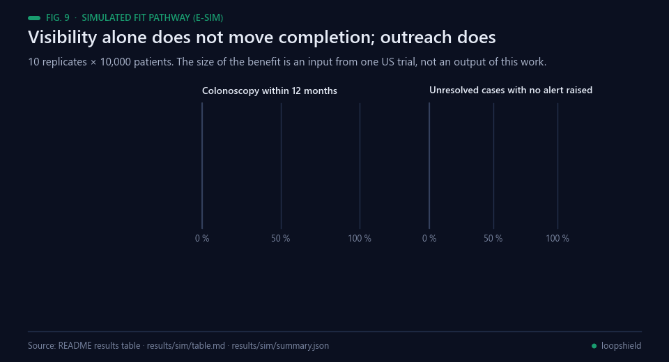<br><sub>Fig. 9 — The simulated pathway. Data: the table below and results/sim/table.md.</sub></p>

### 2. Simulated positive-FIT pathway (E-SIM)

10 replicates × 10,000 patients. Usual-care timing calibrated to the best and worst of four US systems (Chubak 2016);
intervention effect taken from the mFOCUS cluster-randomised trial (Atlas 2023: outreach + navigation +8.5 points
[4.8–12.0] within 120 days of an overdue result; EHR reminders alone, no effect). Tracker arms run through the real
engine.

| System | Arm | Colonoscopy within 12 months | Difference vs usual care [2.5–97.5 pct] | Unresolved cases with no alert raised |
|---|---|---|---|---|
| Low-performing | Usual care | 58.0 % | — | 100 % (assumed: no tracking) |
| Low-performing | Reminders-only tracker | 56.9 % | −1.2 [−5.2, +2.2] | 0 % (measured) |
| Low-performing | **LoopShield** | **62.8 %** | **+4.8 [+1.5, +6.4]** | **0 %** (measured) |
| High-performing | Usual care | 83.9 % | — | 100 % (assumed) |
| High-performing | Reminders-only tracker | 82.9 % | −1.0 [−4.4, +0.1] | 0 % (measured) |
| High-performing | **LoopShield** | **85.8 %** | **+2.0 [+1.1, +2.4]** | **0 %** (measured) |

<p align="center">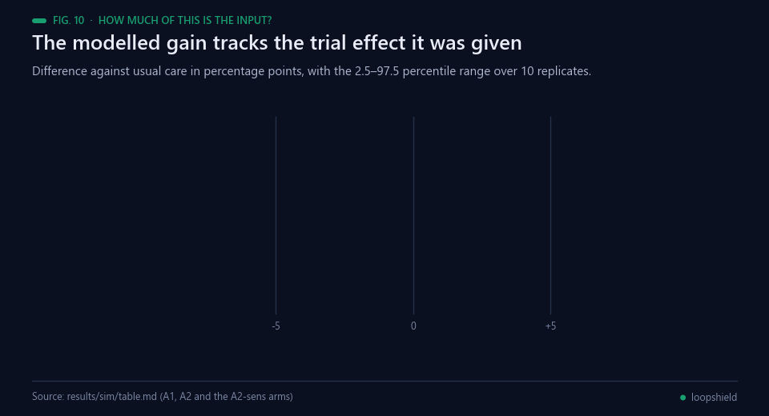<br><sub>Fig. 10 — The modelled gain against the effect it was given. Data: results/sim/table.md.</sub></p>

Full table with sensitivity analysis: [results/sim/table.md](results/sim/table.md). How to read it: the size of the
benefit is an input from one US trial, so the simulation shows what that effect would mean for the pathway, not that
LoopShield produces it; visibility alone (reminders) does not move completion, outreach does. Escalation burden is high in
the low-performing scenario (about 14 escalations per case, 4 in the high-performing one), a real alert-fatigue risk
that a pilot has to tune. An earlier version stopped alerting once the 3-level ladder was used up: 33 % (slow
system) and 83 % (fast system) of late, still-open cases then got no alert after day 60. The current version keeps
reminding the clinical lead every 30 days (0 % without an alert after day 60; median 4.6–6.9 days from day 60 to the next
alert), which is part of that burden. Both runs are kept (`results/sim_v01_ladder_exhausts/`, `results/sim/`).
"Alert" means an escalation recorded by the engine; this prototype has no delivery channel, so delivery and reading
are not measured (FHIR exports them as Communications in `preparation`).

<p align="center">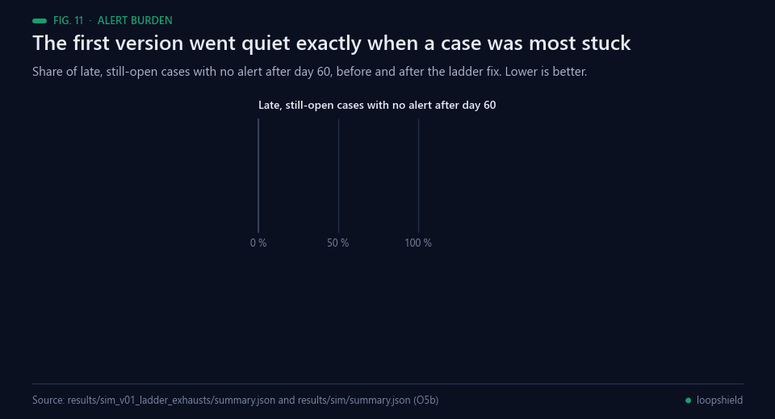<br><sub>Fig. 11 — The alert burden and the ladder fix. Data: both simulation runs in results/.</sub></p>

### 3. Privacy: what reaches an external AI model (E-PHI, own technology)

<p align="center">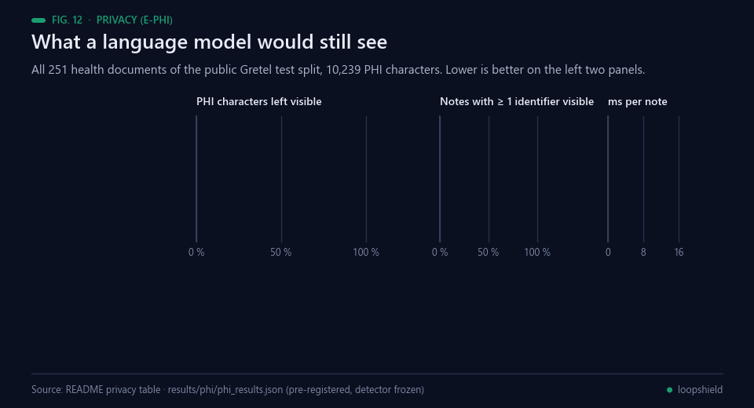<br><sub>Fig. 12 — What a model would still see. Data: the table below and results/phi/phi_results.json.</sub></p>

Pre-registered benchmark on all 251 health documents of the public Gretel `gretel-pii-masking-en-v1` test split
(synthetic, Apache-2.0), 10,239 PHI characters. Lower exposure is better. The NAVAJO v2 detector was frozen before this
run (Agnuxo1/edge-privacy-gateway commit 1bea827) and not tuned on this data.

| What is sent to the model | PHI characters left visible [3 partitions, mean ± SD] | Notes with ≥ 1 identifier fully visible | Precision of masking | Clinical values kept (n = 33) | ms per note |
|---|---|---|---|---|---|
| Raw note | 100 % | 100 % | — | 100 % | — |
| Microsoft Presidio (control, default English, spaCy lg) | 22.8 % (22.7 ± 2.2) | 49.8 % | 0.82 | 90.9 % | 15.4 |
| NAVAJO v1 (before this work) | 28.3 % (28.0 ± 5.7) | 47.8 % | 0.44 | 97.0 % | 0.19 |
| **NAVAJO v2 (default mode, no ML model)** | **12.9 %** (12.9 ± 1.5) | **21.9 %** | **0.88** | **100 %** | **0.32** |
| **NAVAJO v2 + Presidio (maximum mode)** | **4.1 %** (4.0 ± 1.3) | **6.4 %** | 0.83 | 90.9 % | 13.8 |

<p align="center">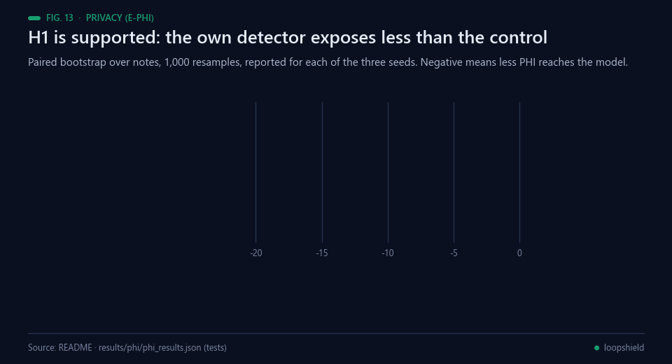<br><sub>Fig. 13 — The pre-registered contrast, reported per seed. Data: results/phi/phi_results.json.</sub></p>

Paired bootstrap over notes (1,000 resamples, seeds 0/1/2): NAVAJO v2 − Presidio = **−9.9 points**
[−13.7, −6.5] / [−13.4, −6.7] / [−13.3, −6.5]; hybrid − Presidio = **−18.8 points** [−21.3, −16.3] / [−21.0, −16.5] /
[−21.2, −16.4]. H1 (own technology lowers exposure versus the professional control) is supported. The final guard
would have refused to send 1 of 251 notes (0.4 %) in default mode. Limits: one synthetic English dataset, whose health
documents were partly inspected (200) in the NAVAJO v2 project's exploratory pilot; small clinical-value sample; even the
best mode leaves 4 % of PHI characters visible, so a data-processing agreement or a local model is still required.
Results: [results/phi/phi_results.json](results/phi/phi_results.json).

## Repository

<p align="center">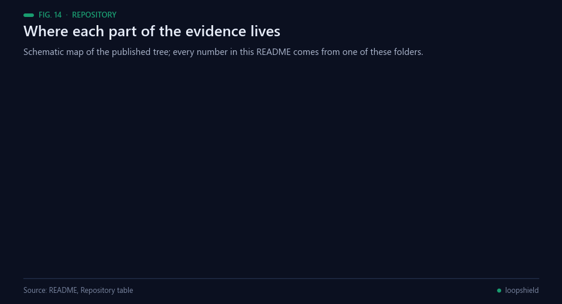<br><sub>Fig. 14 — Where each part of the evidence lives. Source: the table below.</sub></p>

| Path | Content |
|---|---|
| `loopshield/` | engine, pathways, messages, privacy gateway, FHIR export, NAVAJO v2 detector (vendored) |
| `vendor/navajo_egp/` | Project NAVAJO core (MIT, same author) |
| `demo/` | offline demo board (`demo/out/dashboard.html`, 300 synthetic cases + 1 urgent) |
| `sim/` | pathway simulation, fuzzer, table script |
| `bench/` | privacy benchmark |
| `experiments/` | pre-registration and log |
| `results/` | outputs of the runs reported above |
| `docs/SUBMISSION.md` | technical documentation for the challenge: requirements, governance, assumptions, dependencies, limitations |

## Limitations

<p align="center">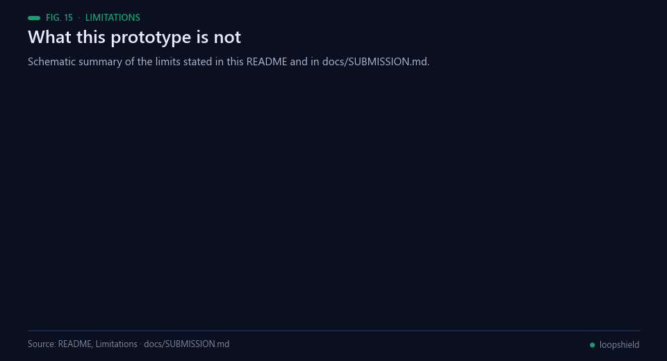<br><sub>Fig. 15 — Schematic summary of the limits stated here and in docs/SUBMISSION.md.</sub></p>

Synthetic data only; no EHR, laboratory or messaging integration yet; effect sizes transferred from US studies; Arabic
limited to message templates (no Arabic de-identification evaluated); NAVAJO masking reduces exposure but does not
anonymise, and pseudonymised data remain personal data; FHIR output structurally tested only. Full list in
[docs/SUBMISSION.md](docs/SUBMISSION.md#8-assumptions-dependencies-and-limitations).

## Real-world applications

<p align="center">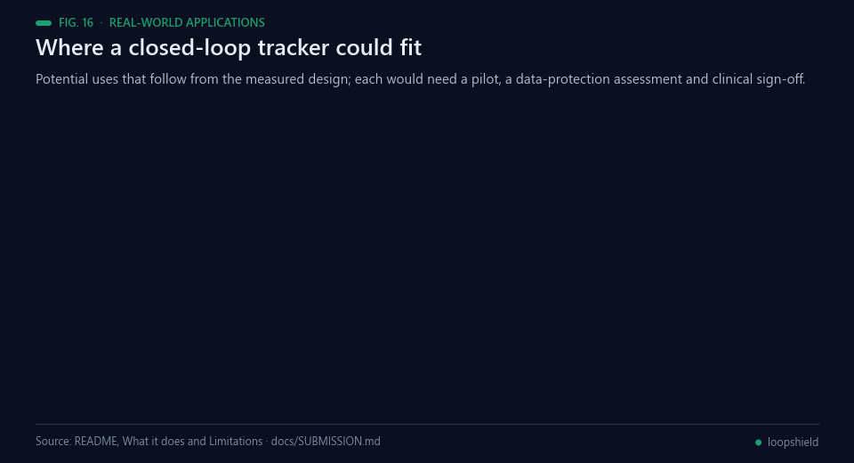<br><sub>Fig. 16 — Potential uses that follow from the measured design. Each would need a pilot and sign-off.</sub></p>

Nothing below is deployed: this is a prototype on synthetic data, and each use would need a pilot, a
data-protection assessment and clinical sign-off.

- **Screening programmes.** Positive FIT and recalled mammograms are the two pathways already configured,
  each with an owner and a deadline per step; a programme would replace the prototype's default days with
  its own.
- **Primary-care safety nets.** The accountable owner changes with the step, so a result waiting on a family
  doctor appears as theirs rather than as a line in a shared queue.
- **Audit and inspection.** A hash-chained record of every event, with an anchor hash held outside the log,
  is the kind of evidence an inspector can check without trusting the system that produced it [[12](#ref-12)].
- **Hand-off between providers.** FHIR R4 Task, Communication and Provenance resources carry the case to the
  next organisation [[14](#ref-14)]; the output is structurally tested, not yet exchanged with a live server.
- **Assistants without exposure.** If a model drafts the patient message, identifiers are replaced on the
  hospital machine first and the answer is restored there; under the GDPR the masked text is still personal
  data [[18](#ref-18)], so a processing agreement or a local model is still required.
- **Measuring the gap.** The same engine that tracks cases counts what was never followed up — the number
  the literature keeps having to estimate from the outside [[5](#ref-5), [6](#ref-6)].

## Possible improvements

<p align="center">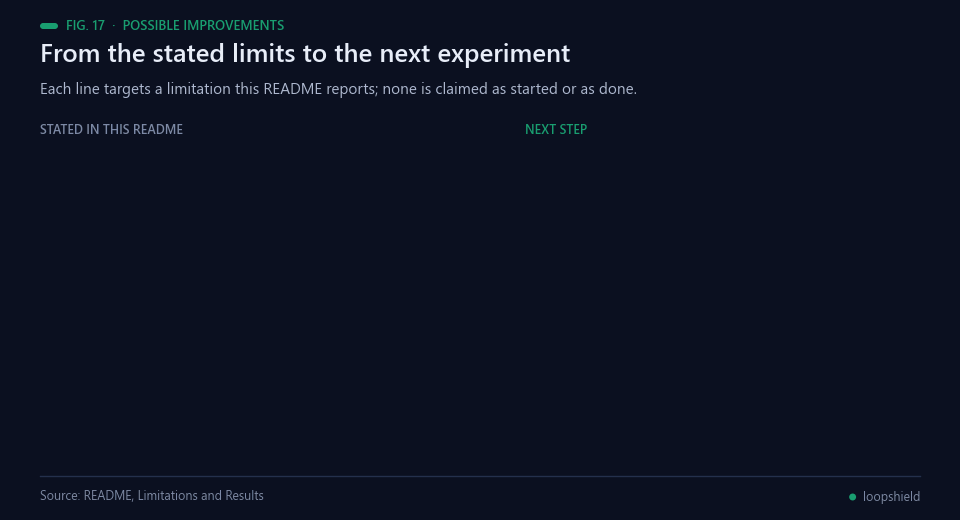<br><sub>Fig. 17 — Each line targets a limitation this README reports. None is claimed as started.</sub></p>

- **A prospective pilot.** The benefit in the simulation is an effect size transferred from a US trial
  [[1](#ref-1)] into a modelled pathway; with the effect set to zero the modelled gain is zero. Only a pilot in
  one service, reported against its own baseline, can turn that into evidence.
- **Tune the alert burden against a real inbox.** About 14 escalations per case in the low-performing
  scenario is a plausible route to alert fatigue, and the fix for the silent gap — reminding the clinical
  lead every 30 days — is part of that burden. The prototype records alerts; it does not deliver them, so
  delivery and reading are unmeasured.
- **Close the residual 4 %.** Even maximum mode leaves 4.1 % of PHI characters visible. A narrative-text
  detector evaluated on consented real notes under a new frozen protocol, with the existing guard kept as
  the last line, is the next step.
- **Arabic, properly.** Arabic exists as message templates pending native-speaker and clinical review, and
  no Arabic de-identification has been evaluated at all.
- **Exchange real FHIR.** The Task and Communication resources are checked for structure; exchanging them
  with a FHIR server and a laboratory feed in a sandbox would test the hand-off that the whole design rests
  on [[14](#ref-14)].

## Future work

<p align="center">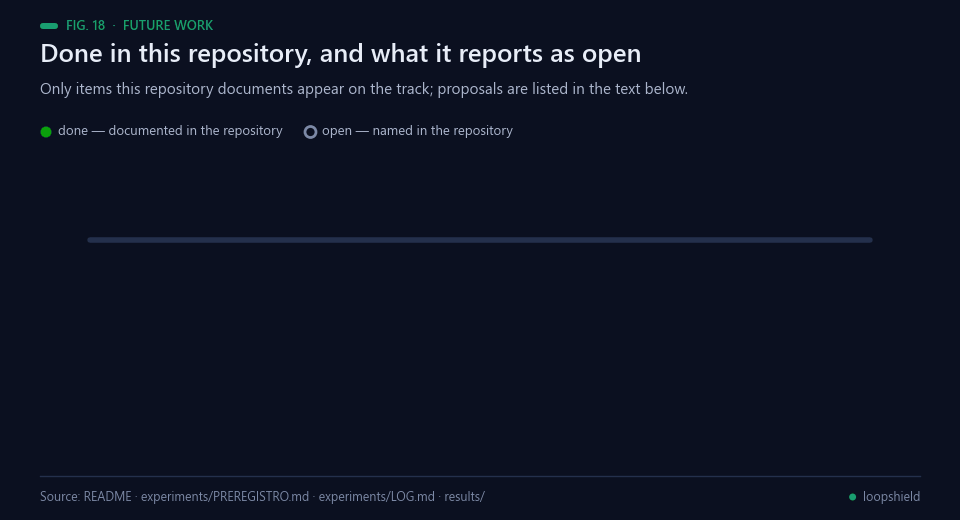<br><sub>Fig. 18 — Only items this repository documents appear on the track.</sub></p>

Documented in this repository:

1. A pre-registration written before any run ([`experiments/PREREGISTRO.md`](experiments/PREREGISTRO.md)),
   with every run including the negative ones in [`experiments/LOG.md`](experiments/LOG.md).
2. The engine fuzzed over 100,000 random sequences and 1,544,139 events with zero invariant violations.
3. The pathway simulation, 10 replicates per arm in both calibrated scenarios.
4. The privacy benchmark over all 251 health documents of the public Gretel test split, with the detector
   frozen before the run.
5. The escalation-ladder fix, with the superseded v0.1 run kept beside the current one.

Named in this repository as open: no clinic uses it, it is not a medical device, and there is no EHR,
laboratory or messaging integration.

**Proposed next steps (not commitments).** These are suggestions from this README build, not the author's
published plan: a prospective pilot in one service; tuning the ladder against a real inbox and measuring
delivery rather than only the record; a narrative-text detector evaluated on consented notes; Arabic
de-identification and a native-speaker review of the templates; and a sandbox exchange of FHIR resources
with a real server.

## Licence

MIT. See [NOTICE](NOTICE) for vendored components and data licences.

## Bibliography

1. <a id="ref-1"></a>Atlas, S. J., Tosteson, A. N. A., Wright, A., et al. (2023). A Multilevel Primary Care Intervention to Improve Follow-Up of Overdue Abnormal Cancer Screening Test Results. *JAMA*, 330(14), 1348. https://doi.org/10.1001/jama.2023.18755
2. <a id="ref-2"></a>Chubak, J., Garcia, M. P., Burnett-Hartman, A. N., et al. (2016). Time to Colonoscopy after Positive Fecal Blood Test in Four U.S. Health Care Systems. *Cancer Epidemiology, Biomarkers & Prevention*, 25(2), 344–350. https://doi.org/10.1158/1055-9965.EPI-15-0470
3. <a id="ref-3"></a>Corley, D. A., Jensen, C. D., Quinn, V. P., et al. (2017). Association Between Time to Colonoscopy After a Positive Fecal Test Result and Risk of Colorectal Cancer and Cancer Stage at Diagnosis. *JAMA*, 317(16), 1631. https://doi.org/10.1001/jama.2017.3634
4. <a id="ref-4"></a>Selby, K., Baumgartner, C., Levin, T. R., et al. (2017). Interventions to Improve Follow-up of Positive Results on Fecal Blood Tests. *Annals of Internal Medicine*, 167(8), 565–575. https://doi.org/10.7326/M17-1361
5. <a id="ref-5"></a>Callen, J. L., Westbrook, J. I., Georgiou, A., & Li, J. (2011). Failure to Follow-Up Test Results for Ambulatory Patients: A Systematic Review. *Journal of General Internal Medicine*, 27(10), 1334–1348. https://doi.org/10.1007/s11606-011-1949-5
6. <a id="ref-6"></a>Singh, H., Thomas, E. J., Mani, S., et al. (2009). Timely Follow-up of Abnormal Diagnostic Imaging Test Results in an Outpatient Setting. *Archives of Internal Medicine*, 169(17). https://doi.org/10.1001/archinternmed.2009.263
7. <a id="ref-7"></a>Sittig, D. F., & Singh, H. (2012). Improving Test Result Follow-up through Electronic Health Records Requires More than Just an Alert. *Journal of General Internal Medicine*, 27(10), 1235–1237. https://doi.org/10.1007/s11606-012-2161-y
8. <a id="ref-8"></a>Murphy, D. R., Laxmisan, A., Reis, B. A., et al. (2013). Electronic health record-based triggers to detect potential delays in cancer diagnosis. *BMJ Quality & Safety*, 23(1), 8–16. https://doi.org/10.1136/bmjqs-2013-001874
9. <a id="ref-9"></a>Bretthauer, M., Løberg, M., Wieszczy, P., et al. (2022). Effect of Colonoscopy Screening on Risks of Colorectal Cancer and Related Death. *New England Journal of Medicine*, 387(17), 1547–1556. https://doi.org/10.1056/NEJMoa2208375
10. <a id="ref-10"></a>SWEENEY, L. (2002). k-ANONYMITY: A MODEL FOR PROTECTING PRIVACY. *International Journal of Uncertainty, Fuzziness and Knowledge-Based Systems*, 10(05), 557–570. https://doi.org/10.1142/S0218488502001648
11. <a id="ref-11"></a>Uzuner, O., Luo, Y., & Szolovits, P. (2007). Evaluating the State-of-the-Art in Automatic De-identification. *Journal of the American Medical Informatics Association*, 14(5), 550–563. https://doi.org/10.1197/jamia.M2444
12. <a id="ref-12"></a>Haber, S., & Stornetta, W. S. (1991). How to time-stamp a digital document. *Journal of Cryptology*, 3(2), 99–111. https://doi.org/10.1007/BF00196791
13. <a id="ref-13"></a>Efron, B. (1979). Bootstrap Methods: Another Look at the Jackknife. *The Annals of Statistics*, 7(1), 1–26. https://doi.org/10.1214/aos/1176344552
14. <a id="ref-14"></a>HL7 International (2019). *FHIR Release 4 (v4.0.1)*. Health Level Seven International. https://hl7.org/fhir/R4/
15. <a id="ref-15"></a>Microsoft (2026). *Presidio: context-aware, pluggable and customizable PII de-identification for text and images*. GitHub. https://github.com/microsoft/presidio
16. <a id="ref-16"></a>Gretel AI (2025). *gretel-pii-masking-en-v1: synthetic English documents with PII span annotations* (revision e06eb14, Apache-2.0). Hugging Face. https://huggingface.co/datasets/gretelai/gretel-pii-masking-en-v1
17. <a id="ref-17"></a>Angulo de Lafuente, F. (2026). *Project NAVAJO / edge-privacy-gateway: on-device, session-scoped pseudonymisation for LLM calls* (commit 1bea827, MIT). GitHub. https://github.com/Agnuxo1/edge-privacy-gateway
18. <a id="ref-18"></a>European Parliament and Council (2016). *Regulation (EU) 2016/679 of 27 April 2016 on the protection of natural persons with regard to the processing of personal data (General Data Protection Regulation)*. Official Journal of the European Union L 119/1. https://eur-lex.europa.eu/eli/reg/2016/679/oj/eng

---

<div align="center">
<sub>Built by <a href="https://github.com/Agnuxo1">Francisco Angulo de Lafuente</a> · every figure is an animated
rendering of the published file or the real run named in its footer ·
<a href="#loopshield">back to top ↑</a></sub>
</div>
